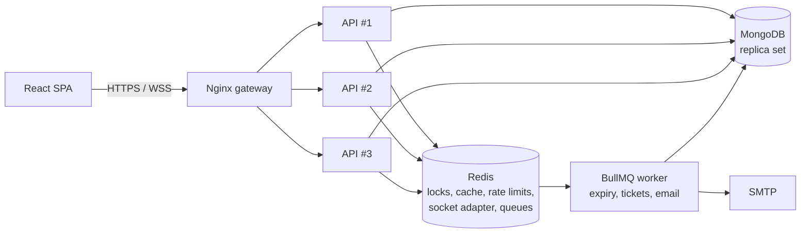

# TicketHub

A real-time event ticket booking platform on the **MERN stack**, built to show system design rather than just CRUD:
atomic seat locking, live seat maps, async job processing, caching with stampede protection, and a horizontally
scalable deployment behind a load balancer.

> **Status:** everything except **online payments** is implemented. Payments are deliberately left out for now;
> the booking flow ends at a clean seam (`confirmBooking`) where the payment webhook plugs in. See [Payments](#payments-planned).

## Features

- **Auth & roles** - JWT access tokens (15 min, in memory) + rotating refresh tokens in an httpOnly cookie with reuse detection; `user` / `organizer` / `admin` RBAC
- **Events** - venues with sectioned seat layouts, pricing tiers, draft → approval → published lifecycle, full-text search, filters, keyset pagination
- **Booking** - pick up to 6 seats, hold them for 5 minutes, live countdown, release or let them expire
- **Live seat map** - every viewer sees seats lock, release and sell within milliseconds (Socket.IO + Redis adapter)
- **Tickets** - QR-code PDF ticket generated in the background and emailed; organizer QR check-in
- **Cancellation** - up to 24h before the event, seats return to the pool transactionally
- **Dashboards** - organizer sales/occupancy stats, admin moderation console
- **Ops** - health checks, Prometheus metrics, structured logs, Dockerized with an Nginx load balancer

## Architecture



A modular monolith: one codebase, one image, run as an API (many replicas) and a worker. Feature modules in
`server/src/modules/*` register their own routes; they talk through service functions, never each other's models,
so any of them could be extracted into a service later. Full write-up in [`docs/`](docs/).

## Design highlights

| Problem | Solution | Where |
|---|---|---|
| Two users pick the same seat | Atomic multi-seat **Lua script** in Redis (`SET`-if-free, all-or-nothing, owner-checked release), TTL = hold time | `booking/seatLock.service.js` |
| Redis loses a lock / bug | **Unique index** `(eventId, seatId)` on sold seats inside a **MongoDB transaction** at confirmation | `booking/booking.service.js` |
| Abandoned checkouts | Redis TTL frees seats; a **delayed BullMQ job** marks the booking expired; a **sweeper** catches lost jobs | `booking/expiry.js`, `workers/` |
| Everyone sees stale seats | **Socket.IO rooms** per event; workers publish via `@socket.io/redis-emitter`; refetch after reconnect | `sockets/`, `common/realtime.js` |
| Slow, repeated reads | **Cache-aside**, `SET NX` mutex against stampedes, TTL jitter, **versioned list keys** for invalidation | `common/cache.js` |
| Slow side effects | Email/PDF/expiry run in a **worker** with retries and exponential backoff | `queues/`, `workers/` |
| Brute force / abuse | **Redis-backed rate limiting** (per IP and per user) with in-memory fallback | `common/rateLimit.js` |
| Stolen refresh token | **Rotation + reuse detection** revokes the whole session family | `auth/token.service.js` |
| Deep pagination cost | **Keyset cursors** on `(startsAt, _id)` instead of skip/limit | `events/event.service.js` |
| Redis outage | Seat map falls back to MongoDB; cache is bypassed; rate limiter fails open | `seatmap.service.js`, `cache.js` |

## Quick start

Requirements: Node 20+, Docker.

```bash
docker compose up -d                      # MongoDB (replica set) + Redis

cd server
cp .env.example .env                      # then set the two JWT secrets
npm install
npm run seed                              # demo users + events
npm run dev                               # API on :4000
npm run worker                            # in a second terminal: background jobs

cd ../client
npm install && npm run dev                # http://localhost:5173
```

**Demo accounts** (created by the seed):

| Role | Email | Password |
|---|---|---|
| Admin | `admin@tickethub.dev` | `Admin@12345` |
| Organizer | `organizer@tickethub.dev` | `Organizer@123` |
| Buyer | `buyer1@tickethub.dev` ... `buyer20@tickethub.dev` | `Buyer@12345` |

Because payments aren't integrated, `.env.example` sets `ENABLE_DEV_CONFIRM=true` so a "Dev: confirm without
payment" button appears at checkout. It is ignored when `NODE_ENV=production`.

**Try it:** open an event in two browsers as different buyers and pick seats in one: they lock instantly in the other.
Confirm a booking and watch the worker terminal: it renders the ticket PDF (written to `server/storage/tickets/`) and logs the email it would send.

### Full stack behind the load balancer

```bash
cp .env.example .env                      # fill in JWT secrets; set NODE_ENV=development + ENABLE_DEV_CONFIRM=true for the demo button
docker compose --profile app up --build --scale api=3
docker compose --profile app run --rm api node scripts/seed.js
```

Open http://localhost. Nginx round-robins across 3 API replicas; WebSockets work without sticky sessions because the
client uses the websocket transport only and fan-out goes through Redis.

## Testing

```bash
cd server && npm test                     # needs Redis on localhost:6379
```

22 tests, including the ones that matter most:

- 100 concurrent requests for one seat → **exactly one** wins
- 80 overlapping multi-seat requests → **no seat is ever granted twice**
- all-or-nothing locking (no partial holds), owner-only release, TTL expiry
- cache stampede: 50 concurrent misses → loader runs **once**
- cursor encoding, seat generation

Load tests in [`infra/k6`](infra/k6):

| Scenario | Result |
|---|---|
| 20 users race for one seat | **1 winner, 19 × `409`, 0 errors** |
| Browse (listing + detail), ramp to 100 VUs, 11.6k requests | **0% failures, p95 ≈ 36 ms, cache hit ratio 99.9%** |

> These numbers were measured on a single small machine against a lightweight MongoDB-compatible database, so treat
> them as indicative. Re-run `infra/k6` on your own hardware and record the results here.

## API overview

Base path `/api/v1`. Full spec: [`docs/03-Database-and-API.md`](docs/03-Database-and-API.md).

| Area | Endpoints |
|---|---|
| Auth | `POST /auth/register` `login` `refresh` `logout`, `GET /auth/verify-email`, `GET /users/me` |
| Events | `GET /events` (search/filter/cursor), `GET /events/:id`, `GET /events/:id/seats` (live map), organizer CRUD + submit |
| Venues | `GET/POST /venues`, `GET /venues/:id` |
| Booking | `POST /bookings/hold`, `DELETE /bookings/:id/hold`, `GET /bookings/:id`, `GET /bookings/me`, `POST /bookings/:id/cancel` |
| Tickets | `GET /tickets/:bookingId`, `GET /tickets/:bookingId/pdf`, `POST /tickets/check-in` |
| Admin | `GET /admin/events/pending`, `POST /admin/events/:id/approve|reject`, `PATCH /admin/users/:id/suspend`, `GET /admin/stats` |
| Organizer | `GET /organizer/events/:id/stats` |
| Ops | `GET /health/live`, `GET /health/ready`, `GET /metrics`, `GET /api/v1/config` |

## Project structure

```
server/src/
  config/        env (zod-validated), mongo, redis, model registry
  common/        errors, validation, auth, rate limit, cache, cursor, metrics, realtime
  modules/       auth users venues events seats booking tickets notifications admin stats system
  queues/        BullMQ queue definitions
  workers/       expiry, email, tickets workers
  sockets/       Socket.IO server
client/src/
  pages/         self-registering routes (each page exports `route` metadata)
  components/    SeatMap, EventCard, forms, stats
  hooks/ api/ store/ lib/
infra/           nginx.conf, k6 load tests
docs/            PRD, system design, DB/API spec, implementation plan
```

## Payments (planned)

Payments are the one piece not built yet. The groundwork is in place so adding them touches very little:

- `confirmBooking(bookingId, { paymentRef })` is already **atomic and idempotent**; the webhook handler will call it
- `extendSeats()` exists to push the seat TTL out when the payment step starts
- The `/config` endpoint already reports `paymentsEnabled: false`, and Checkout has a placeholder payment panel

To add: `POST /payments/create-order` (with `Idempotency-Key`), a signature-verified `POST /webhooks/payment`
that dedupes on the gateway payment id then calls `confirmBooking`, and a refund job wired into `cancelBooking`.
Design in [`docs/02-System-Design.md`](docs/02-System-Design.md) section 5.

## Development notes

- `USE_TRANSACTIONS=false` exists only for a standalone `mongod` without a replica set. It is **not atomic**; use the
  compose replica set for anything real.
- `GET /metrics` is unauthenticated unless `METRICS_TOKEN` is set, and Nginx blocks it from the public internet.
- Suspending a user takes effect when their access token expires (≤ 15 min) since refresh is blocked immediately.

## License

MIT
