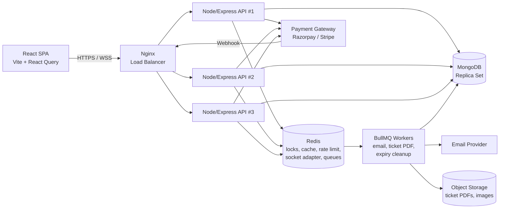
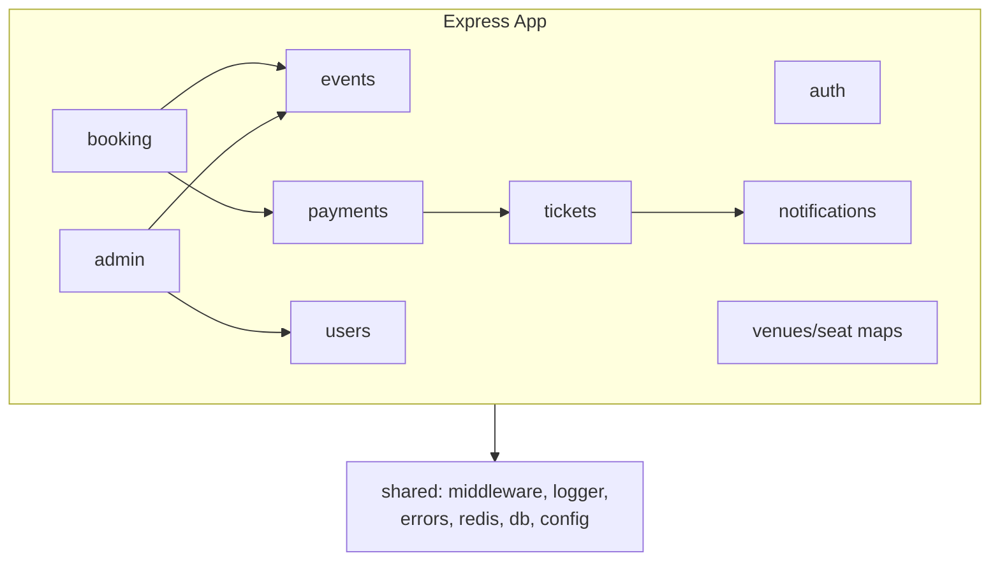
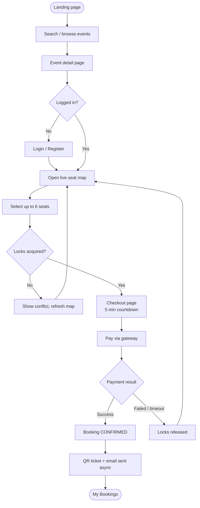
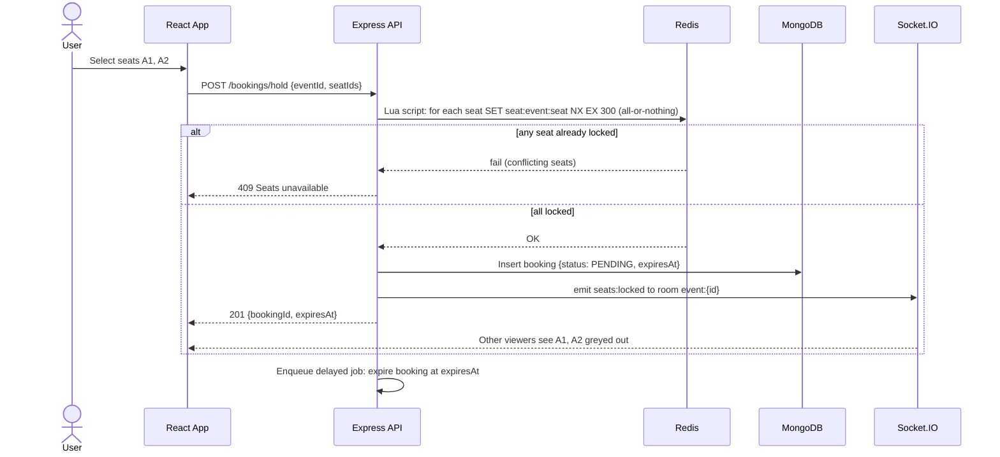
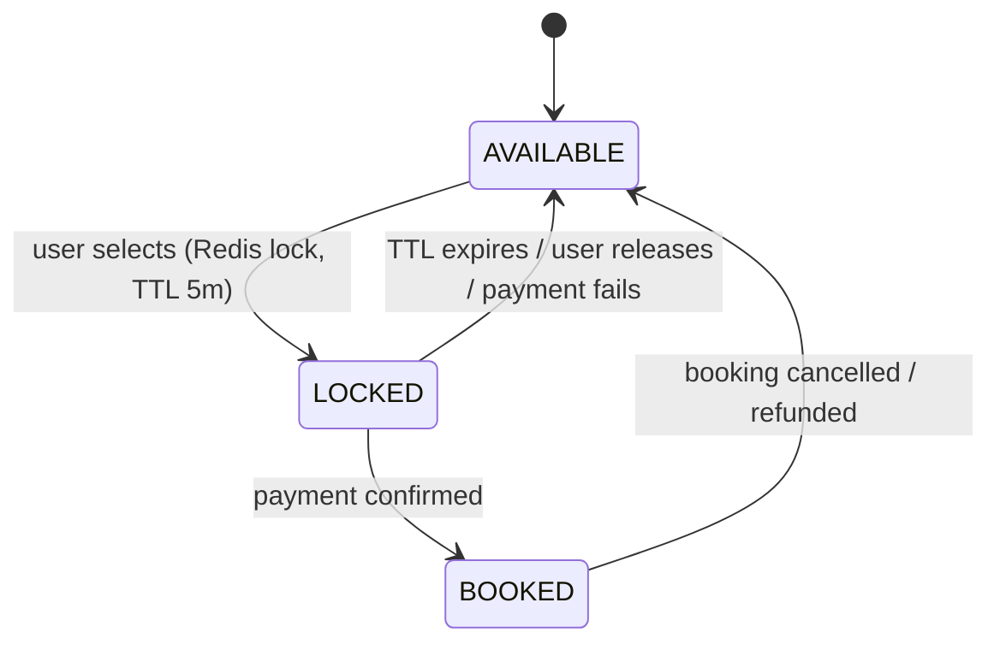
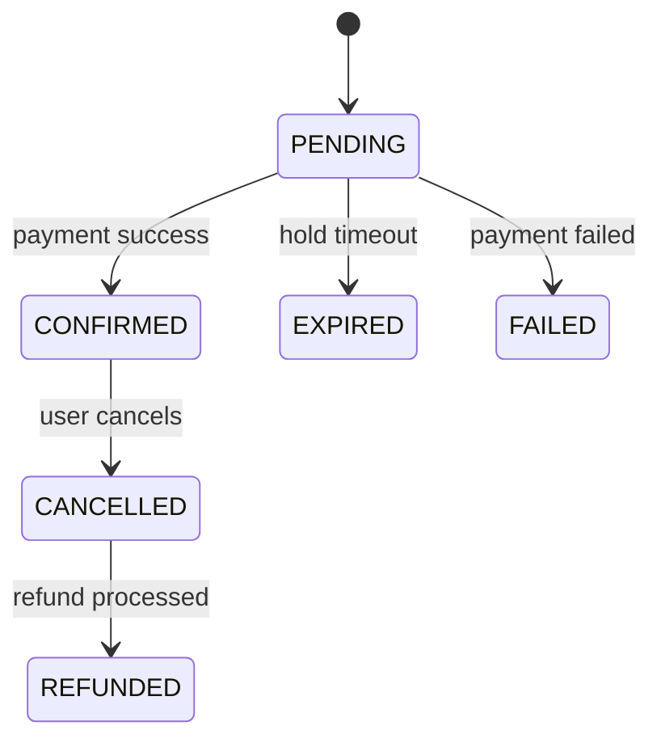
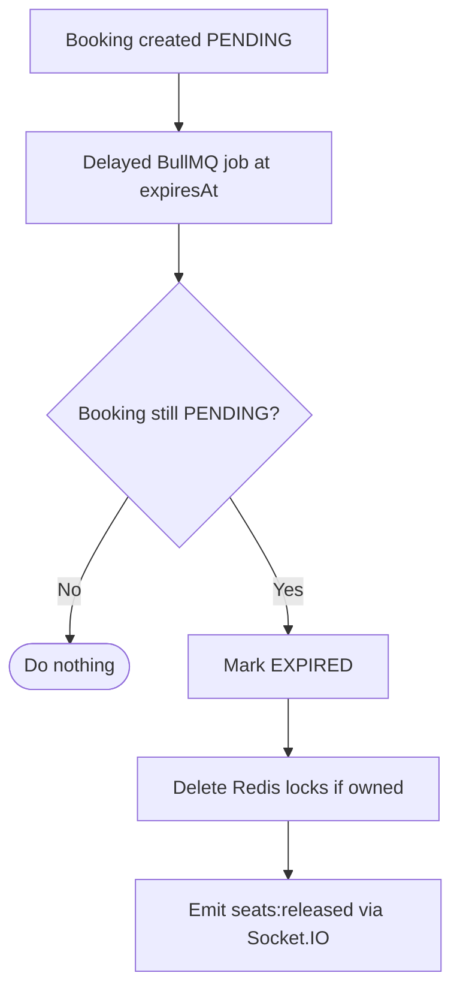
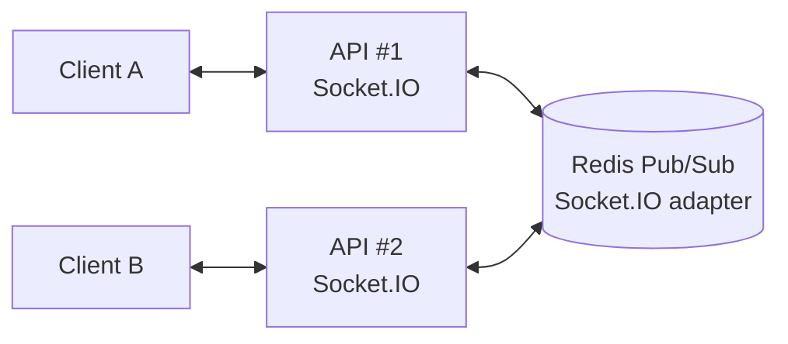
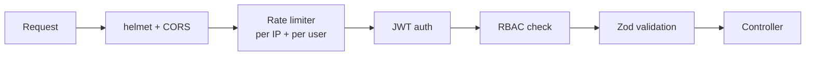

# System Design Document
## TicketHub — Architecture, Flows, and Design Decisions

---

## 1. High-Level Architecture



**Style:** modular monolith. One codebase, one deployable API image, a separate worker process using the same code.

---

## 2. Backend Module Structure



Rule: modules talk through service interfaces, never through each other's models directly. This keeps a future microservice split cheap.

---

## 3. Core User Flow



---

## 4. Seat Locking and Booking Sequence (Centerpiece)



**Why a Lua script?** Locking multiple seats must be atomic. Without it, a user could lock A1, fail on A2, and leave A1 stuck. The script checks all keys, then sets all, or sets none.

**Lock value:** `bookingId` (or `userId:bookingId`) so only the owner can release or extend it (compare-and-delete on release).

---

## 5. Payment and Confirmation Sequence

```mermaid
sequenceDiagram
    actor U as User
    participant FE as React App
    participant API as Express API
    participant PG as Payment Gateway
    participant DB as MongoDB
    participant R as Redis
    participant Q as BullMQ
    participant WS as Socket.IO

    FE->>API: POST /payments/create-order {bookingId} + Idempotency-Key
    API->>R: Verify locks still owned; extend TTL
    API->>PG: Create order (amount, receipt=bookingId)
    PG-->>API: orderId
    API->>DB: Save payment {status: CREATED, orderId}
    API-->>FE: orderId
    FE->>PG: User completes payment
    PG-->>API: POST /webhooks/payment (signed)
    API->>API: Verify signature
    API->>DB: Find payment by gatewayPaymentId (idempotency check)
    alt already processed
        API-->>PG: 200 OK (no-op)
    else first time
        API->>DB: TRANSACTION: payment=PAID, booking=CONFIRMED, seats=BOOKED
        API->>R: Delete seat locks
        API->>WS: emit seats:booked
        API->>Q: Enqueue generate-ticket + send-email
        API-->>PG: 200 OK
    end
```

The final DB write is protected by a **unique index on `(eventId, seatId)` in the `booked_seats` collection**. Even if Redis fails, a double booking cannot be committed.

---

## 6. Seat State Machine



## 7. Booking State Machine



---

## 8. Lock Expiry and Cleanup Flow



Redis TTL is the primary release mechanism. The delayed job is a safety net that cleans DB state and notifies clients.

---

## 9. Real-Time Updates



- Client joins room `event:{eventId}` when opening the seat map
- Server emits deltas only: `{seatIds, status}`
- On reconnect, client refetches the full seat map to resync
- Socket auth via JWT in handshake

---

## 10. Caching Strategy

| Data | Strategy | TTL | Invalidation |
|---|---|---|---|
| Event listing (by filters) | Cache-aside | 60 s | Event publish/update bumps a version key |
| Event detail | Cache-aside | 5 min | On update |
| Seat map (static layout) | Cache-aside | 1 h | On layout edit |
| Seat availability | Not cached long; derived from DB booked seats + Redis locks | n/a | Real-time |
| User session / refresh revocation | Redis | token TTL | On logout |

**Stampede protection:** per-key mutex (`SET lock:cache:key NX EX 5`) and TTL jitter (±10%).

---

## 11. Queue Design (BullMQ)

| Queue | Job | Retries | Notes |
|---|---|---|---|
| `email` | Send verification / confirmation / refund email | 5, exponential backoff | Dead-letter after max |
| `tickets` | Generate QR + PDF, upload to storage | 3 | Idempotent by bookingId |
| `booking-expiry` | Expire unpaid booking | 3 | Delayed job |
| `refunds` | Call gateway refund | 5 | Idempotency key |

Workers run as a separate container so API latency is unaffected.

---

## 12. Security Design



- Access token in memory; refresh token in `httpOnly`, `secure`, `sameSite` cookie
- Refresh token rotation with reuse detection (revoke the whole family on reuse)
- Webhook signature verification and raw body parsing
- Stricter limits on `/auth/*` and `/bookings/hold`
- Passwords hashed with argon2/bcrypt; secrets from env only
- Mongo query sanitization against operator injection

---

## 13. Scalability and Failure Handling

| Scenario | Behavior |
|---|---|
| API instance dies | Nginx routes to healthy instances; stateless so no loss |
| Redis down | Hold endpoint falls back to DB-based holds (`holds` collection with TTL index); cache bypassed; rate limiter fails open with logging |
| Worker down | Jobs persist in Redis; processed on restart |
| Gateway timeout | Booking stays PENDING; reconciliation job polls gateway for status |
| Webhook delayed | Lock TTL extended on order creation; reconciliation catches late payments |
| Payment succeeds but seat lost | Auto-refund flow triggered |

**Scaling path (talking points):** read replicas for Mongo, Redis Cluster, separate WebSocket service, CDN for static assets/images, sharding by `eventId`, and extracting payments/notifications into services.

---

## 14. Observability

- **Logging:** pino JSON logs with `requestId`, `userId`, `eventId`
- **Metrics:** request latency, lock success/failure rate, cache hit ratio, queue depth, active sockets (Prometheus-style `/metrics`)
- **Health:** `/health/live` and `/health/ready` (checks Mongo and Redis)
- **Tracing (optional):** OpenTelemetry

---

## 15. Key Design Decisions and Trade-offs

| Decision | Chosen | Alternative | Why |
|---|---|---|---|
| Architecture | Modular monolith | Microservices | Lower complexity, same boundaries |
| Seat hold | Redis lock + DB unique index | DB-only pessimistic locks | Fast, TTL built in, DB as safety net |
| Pagination | Cursor-based | Skip/limit | Stable and fast on large sets |
| Real-time | Socket.IO | SSE / polling | Rooms, reconnection, adapter support |
| Async work | BullMQ | Cron / inline | Retries, delays, visibility |
| Payments | Webhook as source of truth | Client callback | Client can lie or disconnect |
| Consistency | Mongo transaction at confirm | Eventual only | Booking and seats must change together |
