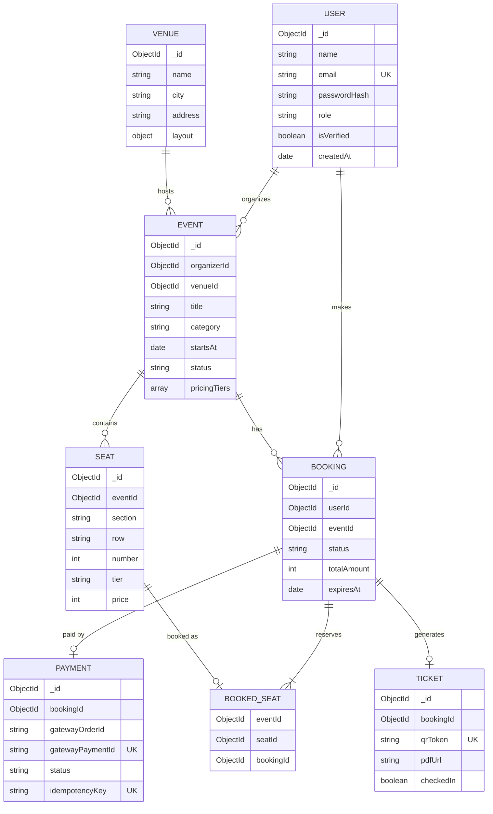

# Database Schema and API Specification
## TicketHub

---

## 1. Entity Relationship Diagram



---

## 2. Collections and Indexes

### users
```js
{ name, email, passwordHash, role: 'user'|'organizer'|'admin', isVerified, createdAt }
```
- `email` unique

### venues
```js
{ name, city, address, layout: { sections: [{ name, rows, cols }] } }
```
- Index: `{ city: 1 }`

### events
```js
{ organizerId, venueId, title, description, category, city, bannerUrl,
  startsAt, endsAt, status, pricingTiers: [{ name, price }], createdAt }
```
- Text index: `{ title, description, city }`
- Compound: `{ status: 1, city: 1, startsAt: 1 }`
- Cursor pagination index: `{ startsAt: 1, _id: 1 }`

### seats
```js
{ eventId, section, row, number, tier, price }
```
- Unique: `{ eventId: 1, section: 1, row: 1, number: 1 }`

### bookings
```js
{ userId, eventId, seatIds: [], status, totalAmount, expiresAt, createdAt }
```
- `{ userId: 1, createdAt: -1 }`
- `{ status: 1, expiresAt: 1 }` for the expiry sweeper

### booked_seats (the double-booking safety net)
```js
{ eventId, seatId, bookingId }
```
- **Unique: `{ eventId: 1, seatId: 1 }`**

### payments
```js
{ bookingId, gatewayOrderId, gatewayPaymentId, amount, status, idempotencyKey, rawWebhook, createdAt }
```
- Unique sparse: `gatewayPaymentId`
- Unique: `idempotencyKey`

### tickets
```js
{ bookingId, qrToken, pdfUrl, checkedIn, checkedInAt }
```
- Unique: `qrToken`

### refresh_tokens (or Redis)
```js
{ userId, tokenHash, familyId, expiresAt, revokedAt }
```
- TTL index on `expiresAt`

---

## 3. Redis Key Design

| Key | Type | TTL | Purpose |
|---|---|---|---|
| `seatlock:{eventId}:{seatId}` | string (value = bookingId) | 300 s | Seat hold |
| `cache:events:list:{hash}` | string (JSON) | 60 s | Listing cache |
| `cache:event:{id}` | string (JSON) | 300 s | Detail cache |
| `cache:version:events` | int | none | Invalidation version |
| `rl:{route}:{ip or userId}` | rate limit counters | window | Rate limiting |
| `rt:revoked:{jti}` | string | token TTL | Revoked tokens |
| `idem:{key}` | string | 24 h | Idempotency responses |

### Atomic multi-seat lock (Lua)
```lua
-- KEYS = seat keys, ARGV[1] = bookingId, ARGV[2] = ttl
for i = 1, #KEYS do
  if redis.call('EXISTS', KEYS[i]) == 1 then return 0 end
end
for i = 1, #KEYS do
  redis.call('SET', KEYS[i], ARGV[1], 'EX', ARGV[2])
end
return 1
```

---

## 4. REST API Specification

Base URL: `/api/v1`. All responses use `{ success, data, error }`. Auth = Bearer access token unless noted.

### Auth
| Method | Endpoint | Description | Auth |
|---|---|---|---|
| POST | `/auth/register` | Register user | Public |
| POST | `/auth/login` | Login, returns access token + sets refresh cookie | Public |
| POST | `/auth/refresh` | Rotate refresh token | Cookie |
| POST | `/auth/logout` | Revoke refresh token | User |
| GET | `/auth/verify-email?token=` | Verify email | Public |
| GET | `/users/me` | Current profile | User |

### Events
| Method | Endpoint | Description | Auth |
|---|---|---|---|
| GET | `/events?q=&city=&category=&from=&to=&minPrice=&maxPrice=&cursor=&limit=` | Search and list | Public |
| GET | `/events/:id` | Event details | Public |
| GET | `/events/:id/seats` | Seat map with live status | Public |
| POST | `/events` | Create event | Organizer |
| PATCH | `/events/:id` | Update event | Organizer (owner) |
| POST | `/events/:id/submit` | Submit for approval | Organizer |
| DELETE | `/events/:id` | Cancel event | Organizer/Admin |

### Venues
| Method | Endpoint | Description | Auth |
|---|---|---|---|
| POST | `/venues` | Create venue and layout | Organizer |
| GET | `/venues/:id` | Venue details | Public |

### Booking
| Method | Endpoint | Description | Auth |
|---|---|---|---|
| POST | `/bookings/hold` | Lock seats, create PENDING booking | User |
| DELETE | `/bookings/:id/hold` | Release held seats | User |
| GET | `/bookings/:id` | Booking details | Owner |
| GET | `/bookings/me?cursor=` | Booking history | User |
| POST | `/bookings/:id/cancel` | Cancel and refund | Owner |

### Payments
| Method | Endpoint | Description | Auth |
|---|---|---|---|
| POST | `/payments/create-order` | Create gateway order (needs `Idempotency-Key` header) | User |
| POST | `/webhooks/payment` | Gateway webhook (signature verified) | Gateway |

### Tickets
| Method | Endpoint | Description | Auth |
|---|---|---|---|
| GET | `/tickets/:bookingId` | Ticket data / PDF URL | Owner |
| POST | `/tickets/check-in` | Validate QR and mark used | Organizer |

### Admin
| Method | Endpoint | Description | Auth |
|---|---|---|---|
| GET | `/admin/events/pending` | Events awaiting approval | Admin |
| POST | `/admin/events/:id/approve` | Approve | Admin |
| POST | `/admin/events/:id/reject` | Reject with reason | Admin |
| PATCH | `/admin/users/:id/suspend` | Suspend user | Admin |
| GET | `/admin/stats` | Platform metrics | Admin |

### Organizer Analytics
| Method | Endpoint | Description | Auth |
|---|---|---|---|
| GET | `/organizer/events/:id/stats` | Sales, revenue, occupancy | Organizer |

### Ops
| Method | Endpoint | Description |
|---|---|---|
| GET | `/health/live` | Liveness |
| GET | `/health/ready` | Readiness (Mongo, Redis) |

---

## 5. Sample Payloads

### POST `/bookings/hold`
Request
```json
{ "eventId": "66f1...", "seatIds": ["66f2...", "66f3..."] }
```
Response `201`
```json
{
  "success": true,
  "data": {
    "bookingId": "66f9...",
    "status": "PENDING",
    "totalAmount": 2400,
    "expiresAt": "2026-10-14T10:05:00.000Z"
  }
}
```
Error `409`
```json
{ "success": false, "error": { "code": "SEATS_UNAVAILABLE", "conflicts": ["66f3..."] } }
```

---

## 6. Socket.IO Events

| Direction | Event | Payload |
|---|---|---|
| Client → Server | `event:join` | `{ eventId }` |
| Client → Server | `event:leave` | `{ eventId }` |
| Server → Client | `seats:locked` | `{ seatIds }` |
| Server → Client | `seats:released` | `{ seatIds }` |
| Server → Client | `seats:booked` | `{ seatIds }` |
| Server → Client | `booking:expired` | `{ bookingId }` (to owner only) |

---

## 7. Error Codes

| Code | HTTP | Meaning |
|---|---|---|
| `VALIDATION_ERROR` | 400 | Invalid input |
| `UNAUTHORIZED` | 401 | Missing or invalid token |
| `FORBIDDEN` | 403 | Role not allowed |
| `NOT_FOUND` | 404 | Resource missing |
| `SEATS_UNAVAILABLE` | 409 | One or more seats taken |
| `HOLD_EXPIRED` | 410 | Hold timed out |
| `DUPLICATE_REQUEST` | 409 | Idempotency key replay |
| `RATE_LIMITED` | 429 | Too many requests |
