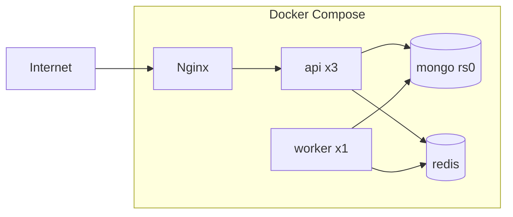

# Implementation Plan
## TicketHub — Structure, Roadmap, Testing, Deployment

---

## 1. Tech Stack

| Layer | Choice |
|---|---|
| Frontend | React 18, Vite, React Router, TanStack Query, Zustand, Tailwind, socket.io-client |
| Backend | Node 20, Express, Mongoose, Zod, Socket.IO, BullMQ, pino |
| Data | MongoDB (replica set, needed for transactions), Redis 7 |
| Payments | Razorpay or Stripe (test mode) |
| Infra | Docker, Docker Compose, Nginx |
| Testing | Jest/Vitest, Supertest, mongodb-memory-server, k6 |
| CI | GitHub Actions |

---

## 2. Repository Structure

```
tickethub/
├── client/
│   └── src/
│       ├── api/            # axios instance, query hooks
│       ├── components/     # SeatMap, EventCard, CountdownTimer
│       ├── features/       # auth, events, booking, dashboard
│       ├── hooks/          # useSocket, useSeatLock
│       ├── pages/
│       └── store/
├── server/
│   └── src/
│       ├── config/         # env, db, redis
│       ├── common/         # middleware, errors, logger, utils
│       ├── modules/
│       │   ├── auth/       # routes, controller, service, schema
│       │   ├── events/
│       │   ├── venues/
│       │   ├── booking/    # seatLock.service.js, lock.lua
│       │   ├── payments/
│       │   ├── tickets/
│       │   ├── notifications/
│       │   └── admin/
│       ├── sockets/
│       ├── queues/         # queue definitions
│       ├── workers/        # email, tickets, expiry, refunds
│       ├── app.js
│       ├── server.js       # API entry
│       └── worker.js       # worker entry
├── infra/
│   ├── nginx/nginx.conf
│   └── k6/booking-load.js
├── docs/                   # these PRD files
├── docker-compose.yml
└── README.md
```

---

## 3. Development Roadmap

```mermaid
gantt
    title TicketHub Build Plan
    dateFormat  YYYY-MM-DD
    axisFormat  Wk %W
    section Foundation
    Setup, auth, RBAC            :a1, 2026-10-19, 7d
    Events CRUD + search UI      :a2, after a1, 7d
    section Booking Core
    Seat map + basic booking     :b1, after a2, 7d
    Redis locks + transactions   :b2, after b1, 7d
    Socket.IO live updates       :b3, after b2, 5d
    section Payments and Async
    Payments + webhooks          :c1, after b3, 7d
    BullMQ: email, tickets, expiry :c2, after c1, 7d
    section Hardening
    Caching + rate limiting      :d1, after c2, 5d
    Dashboards (organizer/admin) :d2, after d1, 5d
    Docker, Nginx, k6, docs      :d3, after d2, 7d
```

~10 weeks part-time; compress or cut P2 items if needed.

### Milestone Checklist

**M1 — Foundation**
- [ ] Project scaffold, ESLint/Prettier, env validation
- [ ] Register/login/refresh/logout with rotation
- [ ] RBAC middleware
- [ ] Event CRUD, venue and seat generation

**M2 — Booking Core**
- [ ] Seat map UI
- [ ] Hold, booking model, unique index on booked seats
- [ ] Redis Lua lock, release, TTL
- [ ] Socket rooms and live updates with Redis adapter

**M3 — Payments and Async**
- [ ] Order creation with idempotency
- [ ] Webhook verification and transactional confirmation
- [ ] Queues: expiry, email, QR/PDF ticket
- [ ] Cancellation and refund

**M4 — Hardening**
- [ ] Cache-aside with versioned invalidation
- [ ] Rate limiting, helmet, Zod on every route
- [ ] Health checks, structured logs, metrics
- [ ] Docker Compose with Nginx and 3 API replicas
- [ ] k6 load tests with documented results
- [ ] README with architecture diagram and trade-offs

---

## 4. Testing Strategy

| Level | What | Tools |
|---|---|---|
| Unit | Services, lock logic, price calculation, validators | Jest/Vitest |
| Integration | API routes with real Mongo/Redis (containers) | Supertest, Testcontainers |
| Concurrency | 100 parallel hold requests on the same seat, expect exactly 1 success | Custom script / Jest |
| Webhook idempotency | Send same webhook 5x, expect 1 booking | Supertest |
| E2E | Search → select seat → pay → ticket | Playwright |
| Load | 500 VUs, mixed browse/hold/pay | k6 |

### Critical test cases
1. Two users lock the same seat simultaneously: one gets 409
2. Multi-seat lock where the second seat is taken: no partial locks remain
3. Lock expires: seat returns to available, clients notified
4. Payment succeeds after the hold expired: seat taken by another, refund triggered
5. Duplicate and out-of-order webhooks
6. Redis restart mid-flow: DB unique index prevents double booking
7. Refresh token reuse: entire token family revoked

### Sample k6 scenario
```js
import http from 'k6/http';
import { check } from 'k6';

export const options = { vus: 200, duration: '60s' };

export default function () {
  const res = http.post(`${__ENV.BASE}/api/v1/bookings/hold`,
    JSON.stringify({ eventId: __ENV.EVENT, seatIds: [__ENV.SEAT] }),
    { headers: { 'Content-Type': 'application/json', Authorization: `Bearer ${__ENV.TOKEN}` } });
  check(res, { 'ok or conflict': r => r.status === 201 || r.status === 409 });
}
```
Expected result: exactly one 201 per seat, remainder 409, no 5xx.

---

## 5. Deployment Architecture



### docker-compose.yml (outline)
```yaml
services:
  nginx:
    image: nginx:alpine
    ports: ["80:80"]
    volumes: ["./infra/nginx/nginx.conf:/etc/nginx/nginx.conf:ro"]
    depends_on: [api]
  api:
    build: ./server
    command: node src/server.js
    deploy: { replicas: 3 }
    env_file: .env
    depends_on: [mongo, redis]
  worker:
    build: ./server
    command: node src/worker.js
    env_file: .env
    depends_on: [mongo, redis]
  mongo:
    image: mongo:7
    command: ["--replSet", "rs0"]
  redis:
    image: redis:7-alpine
```

### Nginx notes
- Upstream with `least_conn`
- WebSocket upgrade headers on `/socket.io/`
- Rate limit zone at the edge as a first layer
- Pass `X-Request-Id`

### Environment variables
```
NODE_ENV, PORT
MONGO_URI, REDIS_URL
JWT_ACCESS_SECRET, JWT_REFRESH_SECRET
ACCESS_TTL=15m, REFRESH_TTL=7d
SEAT_LOCK_TTL=300
PAYMENT_KEY_ID, PAYMENT_KEY_SECRET, PAYMENT_WEBHOOK_SECRET
SMTP_HOST, SMTP_USER, SMTP_PASS
CLIENT_URL
```

### CI/CD (GitHub Actions)
1. Lint and unit tests
2. Integration tests with service containers
3. Build Docker images
4. Deploy to a VPS / Render / Railway via SSH or registry

---

## 6. Definition of Done

- All P0 and P1 requirements implemented
- Concurrency test proves zero double bookings
- Load test results documented (before/after caching)
- README includes architecture diagram, design decisions, and setup in under 5 commands
- Demo deployed with seeded data

---

## 7. Interview Talking Points

1. How the Lua script makes multi-seat locking atomic
2. Why Redis lock plus a DB unique index (defense in depth)
3. Why the webhook, not the client callback, is the source of truth
4. Cache stampede and versioned invalidation
5. Cursor vs offset pagination
6. What breaks if Redis dies, and the fallback
7. How you would split into microservices and shard by `eventId`
8. Measured results from the k6 load test
